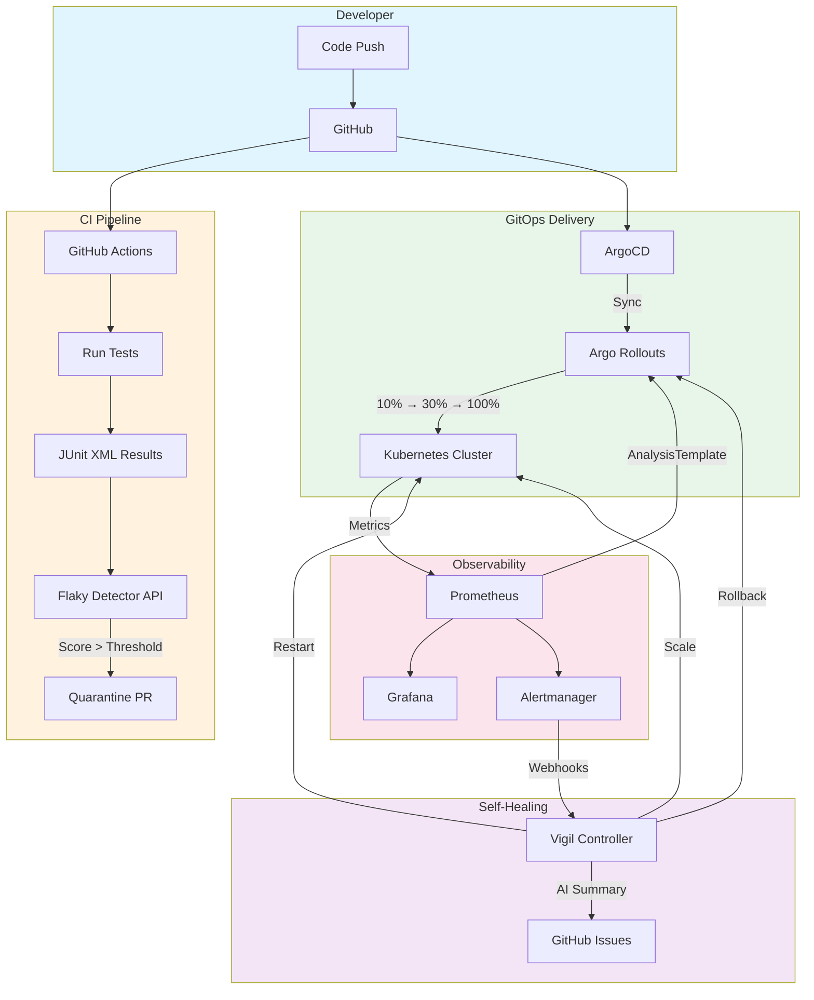

# 🛡️ Vigil

> **Self-healing CI/CD that watches over your deployments**

[](https://github.com/your-org/vigil/actions/workflows/ci.yml)
[](LICENSE)
[](CHANGELOG.md)
[](https://python.org)
[](https://kubernetes.io)

---

## The Problem

**Bad deploys cause outages.** A single misconfigured service can take down production, and most teams discover it after users complain. **Flaky tests waste hours** of developer time with false failures, eroding trust in CI and slowing velocity. Most teams handle both problems by hand.

## The Solution

**Vigil** is an open-source, self-healing CI/CD platform that combines four capabilities:

| Pillar | What It Does |
|--------|-------------|
| 🏗️ **Infra as Code** | Terraform creates clusters and installs ArgoCD, Argo Rollouts, Prometheus, and Grafana |
| 🚀 **Progressive Delivery** | Every deploy goes 10% → 30% → 100% of traffic with automated metric checks at each step |
| 🔧 **Self-Healing Controller** | Reacts to alerts (crash loops, OOM, failed rollouts) with safe automated actions |
| 🔬 **Flaky Test Detector** | ML model scores test flakiness and auto-quarantines flaky tests via PR |

## Architecture



## Features

### 🚀 Progressive Delivery
- Canary deployments with Argo Rollouts (10% → 30% → 100%)
- Automated metric analysis at each step (error rate, p99 latency)
- Instant rollback on metric violations — blast radius limited to ≤10%

### 🔧 Self-Healing Controller
- Receives Alertmanager webhooks and maps alerts to remediation actions
- Configurable rules in YAML: CrashLoopBackOff → restart → rollback
- Safety rails: dry-run mode, max actions/hour, namespace allow-list, full audit log
- Optional AI-powered root cause analysis (behind feature flag)

### 🔬 Flaky Test Detector
- Ingests JUnit XML from CI, tracks test history in Postgres
- Statistical baseline + LightGBM classifier for flakiness scoring
- Auto-quarantines flaky tests via PR with evidence comments
- Grafana dashboard with flakiness leaderboard and CI time saved

### 🏗️ Infrastructure as Code
- Local development with `kind` (one command)
- Production-ready Terraform for AWS EKS (GCP GKE optional)
- Installs full observability stack: Prometheus, Grafana, OpenTelemetry

## Quickstart (5 minutes)

### Local Demo

```bash
pip install vigil
vigil doctor               # Checks Docker, kubectl, kind, helm
vigil demo                 # Creates cluster, installs everything, deploys demo
vigil demo --bad-release   # Watch the canary fail and auto-rollback
```

### On Your Cluster

```bash
helm install vigil oci://ghcr.io/your-org/charts/vigil \
  --namespace vigil --create-namespace \
  -f values.yaml
```

### Flaky Test Detection in CI

```yaml
# .github/workflows/ci.yml
- uses: your-org/flaky-test-action@v1
  with:
    results: "reports/*.xml"
    api-url: ${{ secrets.VIGIL_URL }}
    quarantine: true
```

## Tech Stack

| Component | Technology |
|-----------|-----------|
| **Runtime** | Python 3.11+, FastAPI |
| **Orchestration** | Kubernetes, Helm |
| **GitOps** | ArgoCD, Argo Rollouts |
| **Observability** | Prometheus, Grafana, OpenTelemetry |
| **Infrastructure** | Terraform (kind / AWS EKS / GCP GKE) |
| **ML** | scikit-learn, LightGBM |
| **CI/CD** | GitHub Actions |
| **Storage** | PostgreSQL |
| **Optional** | LLM (Claude/OpenAI) for incident summaries |

## Project Structure

```
vigil/
├── apps/demo-shop/              # Sample microservices (product-api, order-api)
│   ├── product-api/             #   FastAPI + Prometheus metrics + failure injection
│   └── order-api/               #   FastAPI + Prometheus metrics + failure injection
├── controller/                  # Self-healing controller service
│   ├── app/                     #   FastAPI webhooks, rule engine, action executor
│   ├── rules.yaml               #   Remediation rules
│   └── tests/
├── flaky-detector/              # Flaky test detection service
│   ├── app/                     #   API, JUnit parser, ML detector
│   └── tests/
├── cli/                         # `vigil` CLI (Typer)
│   └── vigil_cli/               #   init, install, demo, status, doctor
├── deploy/
│   ├── helm/vigil/              # Helm chart for controller + detector
│   ├── argocd/                  # App-of-apps manifests
│   └── rollouts/                # Canary Rollouts + AnalysisTemplates
├── infra/terraform/
│   ├── modules/local-kind/      # Kind cluster module
│   ├── modules/aws-eks/         # AWS EKS module (VPC, cluster, nodes)
│   └── examples/                # Ready-to-use Terraform examples
├── actions/flaky-test-action/   # Reusable GitHub Action
├── docs/                        # MkDocs documentation site
├── examples/                    # Sample apps using Vigil
├── tests/                       # Unit, integration, and e2e tests
├── .github/workflows/           # CI, release, security workflows
├── Makefile                     # Development commands
└── README.md
```

## Metrics

> These are measured from actual demo runs — not invented.

| Metric | Value | Description |
|--------|-------|-------------|
| **Rollback Time** | _TBD_ s | From bad deploy to full rollback |
| **Blast Radius** | ≤ 10% | Traffic exposed to errors during canary |
| **Flaky Detection F1** | _TBD_ | LightGBM vs. baseline on iDFlakies |
| **CI Time Saved** | _TBD_ | Reruns avoided after quarantine |
| **MTTR** | _TBD_ | With vs. without controller |

## Development

```bash
# Clone and set up
git clone https://github.com/your-org/vigil.git
cd vigil

# Install dev dependencies
make dev

# Run all tests
make test

# Run linters
make lint

# Build Docker images
make docker-build

# Serve docs locally
make docs
```

## Roadmap

- [x] **Phase 1**: Foundation — demo apps, project structure, metrics
- [ ] **Phase 2**: Infrastructure — Terraform, kind, ArgoCD
- [ ] **Phase 3**: GitOps + Canary — Argo Rollouts, auto-rollback
- [ ] **Phase 4**: Self-healing controller — webhooks, rules, actions
- [ ] **Phase 5**: Flaky test detector — ML model, quarantine PRs
- [ ] **Phase 6**: CLI + packaging — Helm, GitHub Action, PyPI
- [ ] **Phase 7**: Quality + security — tests, scanning, signing
- [ ] **Phase 8**: Docs + release — MkDocs, v0.1.0, launch

## Contributing

We welcome contributions! See [CONTRIBUTING.md](CONTRIBUTING.md) for guidelines on:
- Setting up the development environment
- Running tests and linters
- Submitting pull requests
- Code style and commit conventions

## License

[Apache License 2.0](LICENSE) — see [LICENSE](LICENSE) for details.

## Security

See [SECURITY.md](SECURITY.md) for our security policy and how to report vulnerabilities.
